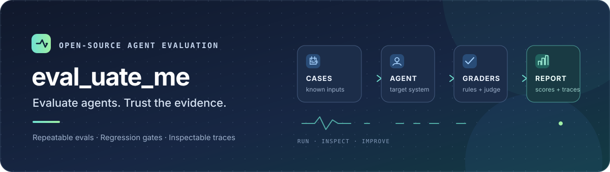

<p align="center">
  
</p>

**A practical evaluation harness for testing AI agents with repeatable cases, inspectable evidence, and regression gates.**

`eval_uate_me` is a small, plugin-based Python framework for running an agent against a dataset, scoring its behavior with deterministic rules or an LLM judge, and reviewing the results case by case. It helps teams answer three questions: did the agent behave correctly, what evidence supports the score, and would the evaluation catch a regression?

```text
cases.jsonl → Runner → Target agent → Graders → Results, traces, reports, and regression gates
```

## What it provides

- **Repeatable evaluations:** run the same dataset and configuration across agent versions.
- **Flexible targets:** evaluate a Python function, HTTP service, command, or custom plugin.
- **Mixed grading:** use exact rules for schemas, labels, and tool behavior; use an LLM judge for open-ended quality.
- **Inspectable evidence:** keep per-case outputs, grader reasons, errors, costs, latency, and traces.
- **Regression checks:** compare runs with a baseline and block meaningful drops in CI.
- **Evaluation quality checks:** use mutation-based meta-evaluation to find cases where a weak grader accepts broken outputs.
- **AI-assisted discovery:** the current main branch can generate capability and red-team candidate suites with separate reports. This feature is added in v1.0.9.

The core package has no runtime dependencies and supports Python 3.11+. Agent and model provider dependencies are installed separately for each target.

## What the project does

The harness evaluates AI agents against repeatable datasets and configurable target adapters. Deterministic graders check
verifiable contracts such as schemas, labels, and tool behavior; an LLM judge scores open-ended qualities such as helpfulness
and tone. Each run records case-level outputs, grader explanations, errors, costs, latency, and available traces. Baseline
comparison and CI gates help detect regressions, while mutation-based meta-evaluation reveals grader blind spots.

The current working branch also supports AI-assisted evaluation discovery. Given an agent description and optional tools,
schemas, system prompt, existing cases, and traces, it generates capability and red-team candidate suites, reports them
separately, and drafts an advisory remediation prompt from observed red-team failures. Generated cases require review before
being treated as trusted benchmark labels.

The repository keeps the original customer-support Agent source under `examples/customer_triage_eval/`. It is a separate upstream project, not an evaluation fixture shipped by this harness.

## Documentation

| File | Contents |
|---|---|
| [docs/TUTORIAL.md](docs/TUTORIAL.md) | Step-by-step guide to installing, running, grading, and gating an evaluation |
| [docs/REFERENCE.md](docs/REFERENCE.md) | Commands, options, configuration keys, reports, and AI-assisted discovery |
| [docs/API.md](docs/API.md) | Python API for writing targets, graders, and judge backends |
| [docs/DESIGN.md](docs/DESIGN.md) | Architecture, design trade-offs, and known limitations |
| [docs/RELEASING.md](docs/RELEASING.md) | Release history and instructions for preparing a release |
| [docs/ci/eval-on-pull-request.yml](docs/ci/eval-on-pull-request.yml) | Optional GitHub Actions template for reporting evaluation regressions on pull requests |

The latest release is **v1.0.9**. The core package has no runtime dependencies and supports Python 3.11+. Licensed under the [MIT License](LICENSE).
